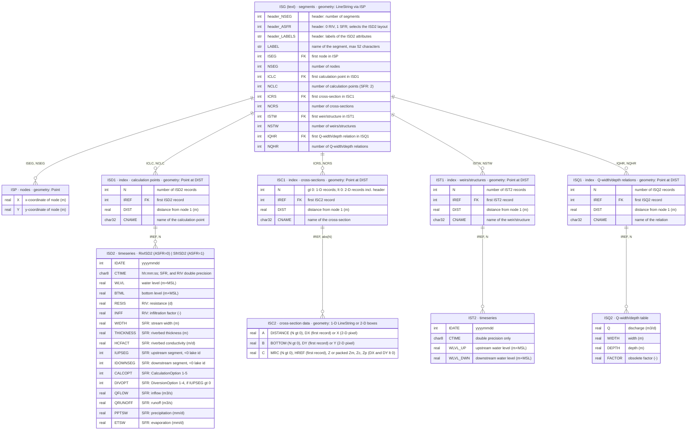
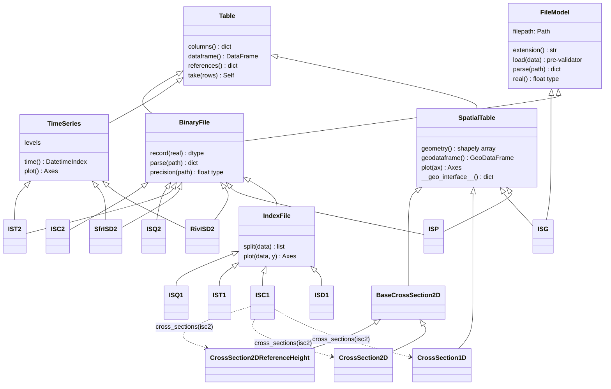

# ISG

Reader for iMOD ISG-files (iMOD User Manual 5.6.1, section 9.9): a text file
of segments with eight associated binary files, related by record numbers.

Examples:
```python
import numpy as np
from imod.formats.isg import ISG

isg = ISG.read("DBASE/SFR.ISG")  # precision from the ISP-file
isg = ISG[np.float32]("DBASE/SFR.ISG")  # or explicit
isg.dataframe()  # segments
isg.geodataframe()  # segments as LineStrings
isg.isd2.dataframe()  # any associated file
isg.isc1.cross_sections(isg.isc2)  # ISC2 records per ISC1 cross-section
isg.cross_sections()  # the same, 1-D cross-sections located on their segment
isg.locate("isd1")  # calculation points as Points on their segment
isg.plot()  # segments with the located ISD1, ISC1, IST1, ISQ1 records
isg.cross_sections()[0].plot()  # a 1-D profile, or the "pixels" of a 2-D grid
isg.isd1.split(isg.isd2)[0].plot()  # levels of calculation point 1 over time
isg.isd1.plot(isg.isd2, "wlvl")  # WLVL of all calculation points
isg.isq1.split(isg.isq2)[0].plot()  # width and depth against Q
```

Models are frozen and their vectors read-only by design.

## Files

Every binary file starts with a header record that stores the record length as
`reclen * 256 + 247`. Records are numbered from 1 after that header. A
reference is a pair (first record, number of records); `0, 0` references
nothing. Reals are 4 bytes (single precision) or 8 bytes (double precision).

- **FK**: first record number of a range in the associated file.
- **index**: the \*1-files only point into their \*2-file, with a name and a
  distance along the segment.
- **geometry**: coordinates, exposed through `geometry()`, `geodataframe()`
  and `__geo_interface__`.



Negative values are never record numbers: ISC1 `N < 0` marks a 2-D
cross-section of `abs(N)` records, `IUPSEG`/`IDOWNSEG < 0` are lake ids and
`Zp < 0` marks cells only inundated above `HREF`.

## Architecture

Each file is a Pydantic model with one numpy vector per attribute, generic over
the float type (`ISP[np.float32]`, `ISP[np.float64]`). A model given a path
reads its missing fields from the file with its own `extension()`, so the
associated files only need the path of the ISG-file.



- `common.py`: base classes, `Vector` and the `References` marker.
- `isg.py`: the file models.
- `views.py`: the cross-sections, typed views of ISC2 records.
- `enums.py`, `validators.py`, `utils.py`: enums, reusable validators, file
  reading helpers.

Fields annotated with `References(file, count)` are checked in one validator
on `ISG`: each range must lie within the referenced file.
